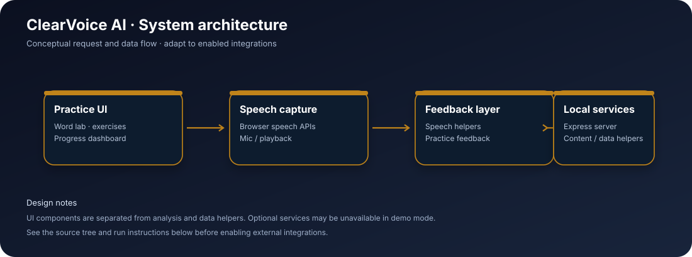

<div align="center">

# ClearVoice AI

### Speech practice · Pronunciation coaching · Progress insights

A speech clarity and pronunciation practice experience with guided exercises, a word lab, practice sessions, and progress views. It combines browser speech capabilities with a lightweight local server and content/data helpers.

</div>

<p align="center">
  
</p>

<p align="center">
  <strong>Product concept</strong> &nbsp;·&nbsp; <strong>Modular frontend</strong> &nbsp;·&nbsp; <strong>Developer-ready setup</strong>
</p>

---

## At a glance

| | Details |
|---|---|
| **Application** | ClearVoice AI |
| **Frontend** | React + TypeScript + Vite |
| **Styling / motion** | Tailwind CSS 4, custom CSS, Framer Motion where used |
| **Core experience** | Speech practice · Pronunciation coaching · Progress insights |
| **Run locally** | `npm install` → `npm run dev` |
| **Production build** | `npm run build` |

## Product visuals


> **Visual note:** the gallery below uses original artwork shipped with the app, not fabricated browser screenshots. Add fresh full-page screenshots here after launching the app locally if you want a true UI gallery for a portfolio or GitHub showcase.

## What it does

- Guided speaking practice flow
- Pronunciation and word-focused lab
- Exercise library and practice prompts
- Progress dashboard and score visualizations
- Speech capture and playback helpers
- Local server for app content and persistence

## Technology stack

`React 19` · `TypeScript` · `Vite 7` · `Tailwind CSS 4` · `Framer Motion` · `Lucide React` · `Browser Speech APIs` · `Node.js + Express` · `Local data helpers`

The exact responsibilities of optional services and browser APIs are described below. This README documents the code included in this repository; it does not imply that third-party AI credentials, hosted model endpoints, or cloud services have been configured.

## Architecture



### Request and data flow

```text
User prompt / word → microphone or text input → browser speech tools
                         ↓
              analysis and feedback presentation
                         ↓
              progress view ← local server/data helpers
```

### Component / repository map

```text
src/
├── pages/          # Home, practice, exercises, word lab, progress
├── components/     # Layout, score ring, charts, logo, count-up
├── lib/            # Speech, audio, API, content and typed models
├── App.tsx         # Routes and app shell
└── index.css       # Global styles
public/images/      # Coach, microphone and soundwave artwork
server/             # Express entry point, content and data helpers
vite.config.ts      # Vite configuration
```

## Getting started

### Prerequisites

- **Node.js:** use Node.js 22 LTS for the most consistent Vite/TypeScript toolchain. Check the `engines` field in `package.json` for the project-specific minimum.
- **npm:** included with Node.js.
- **Python:** required only for the optional Python helper/analysis path where noted below.
- A modern browser. Microphone-dependent features require permission and work best in a secure context (`localhost` is generally allowed).

### Install and launch

Run commands from the project root (folder containing `package.json`).

```bash
npm install
npm run dev
```

Open the local URL printed by Vite (usually `http://localhost:5173`). To start the local content/data API in another terminal:

```bash
npm run server
```

Allow microphone access when prompted. Speech recognition support differs between browsers; Chrome/Edge are sensible first choices for local testing.

### Build and quality checks

Run the checks supported by this project's `package.json`:

```bash
npm run lint
npm run build
```

A successful development-server start is not the same as a successful production build. Resolve any TypeScript, lint, or build output before deploying.

## Optional services and integrations

The local Node server is started with `npm run server` and uses `server/index.mjs`, `server/content.mjs`, and `server/db.mjs`. For microphone and speech-recognition features, grant browser permission and use a supported browser.

## Configuration

- Review `package.json` for the scripts actually provided by this project.
- Review `vite.config.ts` for local development and proxy configuration.
- Do not commit API keys, private recordings, personal transcripts, or local database files.
- If you add external AI or speech providers, place credentials in environment variables and document required variable names in an `.env.example` file. Never publish real secrets in the README or source control.

## Deployment notes

1. Install dependencies using the supported Node.js version.
2. Run `npm run build` and make sure it finishes successfully.
3. Deploy the generated `dist/` directory to a static host that supports SPA fallback routing if client-side routes are used.
4. If you enable a separate API, deploy it independently and configure the frontend/API base URL and CORS policy for the production origin.
5. Keep optional backend services, database migrations, and model dependencies aligned with the deployment environment.

## Limitations and responsible use

Speech recognition and pronunciation feedback can vary with browser support, microphone quality, accent, and ambient noise. Scores are practice guidance, not a clinical or formal language-proficiency assessment.

## Troubleshooting

| Symptom | What to check |
|---|---|
| `npm` or `node` is not recognized | Install Node.js, restart the terminal, then run `node -v` and `npm -v`. |
| Dependency or TypeScript errors | Run `npm install` in the folder containing this README's `package.json`; then retry `npm run build`. |
| Port already in use | Stop the other process or use the port option supported by the relevant script. |
| Microphone permission denied | Allow microphone access in the browser and check the operating-system input device. |
| Optional API does not respond | Start its server in a second terminal and confirm its configured port and proxy. |
| Analysis results look like demo output | Check which local services/models are installed and enabled; the frontend alone does not guarantee hosted AI inference. |

## Project status

This repository is a development project. Verify the production build and the behavior of optional integrations in your own environment before presenting it as a production service. See the source files linked in the repository tree to trace each feature to its implementation.

---

<div align="center">

**ClearVoice AI** · Built with React, TypeScript, and a focus on clear product workflows.

</div>
